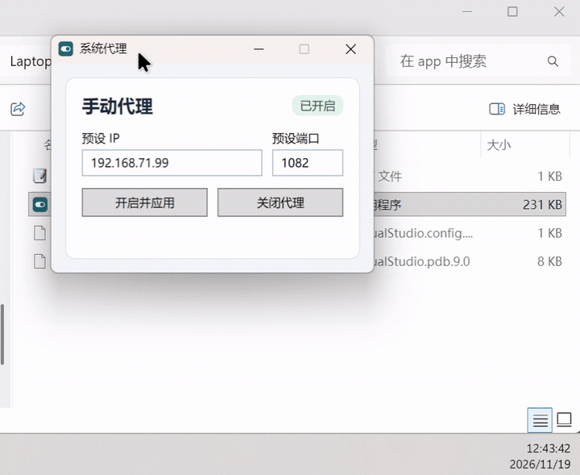
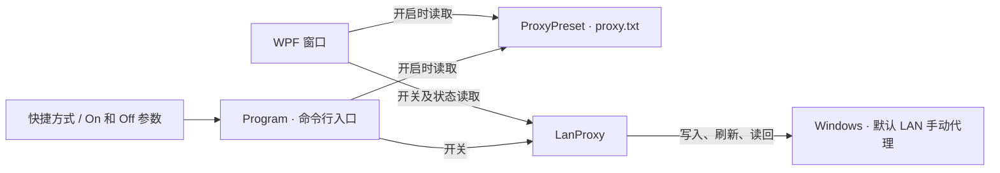

# Windows Proxy Switch

一个用于快速开启和关闭 Windows 11 手动代理的桌面工具。代理服务器由用户提供，每次开启时从外部文件读取同一组预设 IP 和端口。适合经常在直连和固定代理之间切换的场景。



## 功能

- **一键开关**。可以通过 WPF 窗口、批处理命令或桌面快捷方式操作。
- **状态与反馈**。窗口右上角显示 Windows 当前的手动代理状态，按钮下方显示本次操作的结果或错误原因。
- **外部配置**。窗口只读展示 `proxy.txt` 中的预设，开启时重新读取文件。关闭只切换手动代理开关。
- **桌面常驻**。主窗口置顶，支持最小化到通知区域，也可贴屏幕上缘、左缘和右缘隐藏。

## 使用方法

1. 在 `app` 目录准备 `ProxySwitch.exe`、随程序生成的 `ProxySwitch.exe.config` 和 `proxy.txt`。运行已编译的程序使用 Windows 11 自带的 .NET Framework 4.8 或 4.8.1。[Windows 上的 .NET Framework](https://learn.microsoft.com/dotnet/framework/install/on-windows-10)
2. 用记事本编辑 `app/proxy.txt`，只留一行实际代理地址。IPv4 写成 `127.0.0.1:7890` 这样的格式，IPv6 写成 `[::1]:7890`。端口范围为 `1` 至 `65535`，请把示例换成自己的代理地址。
3. 双击 `app/ProxySwitch.exe`，选择「开启并应用」或「关闭代理」。文件缺失或内容无效时，开启会报错，关闭仍可使用。

开启会应用文件中的预设地址，并打开 Windows 手动代理开关，即使 Windows 原先保存了其他地址。关闭后，Windows 中保存的地址仍可在设置页查看。Windows 的代理例外、本地地址绕过、自动检测和 PAC 继续按系统原有配置工作。

### 快捷命令

在项目目录执行下列命令，也可直接双击对应的 `.cmd` 文件。

```bat
ProxyOn.cmd
ProxyOff.cmd
```

两个脚本分别执行 `app\ProxySwitch.exe On` 和 `app\ProxySwitch.exe Off`。在 PowerShell 中运行脚本时，文件名前加 `./` 或 `.\`。参数模式下成功退出码为 `0`，失败时显示错误对话框并返回 `1`。

如需放到桌面，可以分别给两个 `.cmd` 创建快捷方式。也可以直接为 `ProxySwitch.exe` 创建快捷方式，在目标路径后加空格和 `On` 或 `Off`。项目现有的两个 `.lnk` 指向生成时的本机程序路径，迁移目录后可重新创建。

### 托盘和贴边

- 点击最小化按钮将窗口收进通知区域。单击「系统代理」图标可恢复，右键可选择「显示窗口」或「退出」。点击标题栏的关闭按钮也可退出。
- 把窗口拖到屏幕上、左或右边缘并松手，鼠标移开后会收成细边条。将鼠标移到边条即可展开，将窗口拖离边缘可解除贴边状态。

## 从源码构建

在 Windows 上安装支持 Windows Desktop 项目的 .NET SDK 和 .NET Framework 4.8 Developer Pack。项目目标框架为 `net48`，已使用 .NET SDK 9.0 构建。[.NET Framework Developer Pack](https://learn.microsoft.com/dotnet/framework/install/guide-for-developers)

如正在运行旧版，先从托盘退出，再在项目目录执行以下命令。

```powershell
dotnet build .\src\ProxySwitch.csproj -c Release -o .\app
```

首次构建后，将自己的 `proxy.txt` 放在 `app` 内，与生成的 `ProxySwitch.exe` 同目录。复制程序时一并保留生成的 `ProxySwitch.exe.config`。

## 架构

WPF 和命令行入口共享配置解析与 WinINet 读写逻辑。托盘、置顶和贴边属于窗口层，命令行模式直接执行一次开关操作后退出。



| 文件 | 职责 |
| --- | --- |
| [`src/Program.cs`](src/Program.cs) | 处理启动参数。直接启动时创建 WPF 窗口，`On` / `Off` 模式直接调用代理层。 |
| [`src/MainWindow.xaml`](src/MainWindow.xaml) 与 [`MainWindow.xaml.cs`](src/MainWindow.xaml.cs) | 定义窗口布局、状态、操作反馈和按钮事件。 |
| [`src/MainWindow.Placement.cs`](src/MainWindow.Placement.cs) | 管理 WinForms `NotifyIcon` 和边条窗口。通过 Win32 移动消息、屏幕工作区和定时器实现贴边收起与展开。 |
| [`src/ProxyPreset.cs`](src/ProxyPreset.cs) | 按程序所在目录定位 `proxy.txt`，校验 IP 与端口，并格式化代理地址。 |
| [`src/LanProxy.cs`](src/LanProxy.cs) | 通过 P/Invoke 调用 WinINet，读取默认 LAN 配置，按需更新手动开关和代理地址，刷新并读回结果。 |
| [`src/ProxySwitch.csproj`](src/ProxySwitch.csproj) 与 [`ProxySwitch.ico`](src/ProxySwitch.ico) | 定义 WPF 和 WinForms 构建配置，并将同一个图标用于程序、标题栏和托盘。 |

### 系统设置与回读

`LanProxy` 通过 `INTERNET_OPTION_PER_CONNECTION_OPTION` 操作默认 LAN 连接。开启时根据预设地址更新服务器选项，开关切换只修改连接标志中的手动代理位。真实变更提交后，程序通知 WinINet 刷新并重新读取代理设置。若配置已满足本次操作，则直接返回读取结果。[WinINet 连接设置](https://learn.microsoft.com/windows/win32/wininet/setting-and-retrieving-internet-options)

适用对象是遵循 Windows 手动代理设置的客户端。WinHTTP 服务、代理环境变量和应用内单独配置的代理都有各自的设置入口。窗口提示「成功」表示 Windows 设置已经确认，网络连通性可在实际使用代理的客户端中检查。[WinINet 的适用范围](https://learn.microsoft.com/windows/win32/wininet/about-wininet)

## 参考与友情推荐

- [WinINet 连接设置文档](https://learn.microsoft.com/windows/win32/wininet/setting-and-retrieving-internet-options) — Windows 默认 LAN 手动代理 API 参考
- [PlcTools.cc](https://plctools.cc) — 专注工业现场与 PLC 调试的轻量实用工具集（本地直连、免登录）
